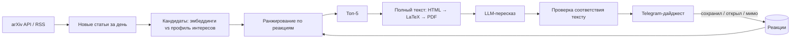

# arxiv-daily-digest

**Персональный дайджест arXiv: каждое утро 5 статей, отобранных под тебя, с пересказами в Telegram.**

> Статус: проектирование. Дизайн-документ — в [`docs/`](docs/).

## Проблема

Только в категории cs.* на arXiv выходят сотни статей в день. Исследователь или инженер не успевает даже пролистать заголовки, поэтому важные работы проходят мимо, а время уходит на ручной разбор лент.

Готовые решения закрывают задачу частично: ленты arXiv не персонализированы, а сервисы рекомендаций не дают проверенного пересказа и не приходят туда, где человек и так читает новости.

## Решение

Бот раз в день:

1. забирает новые статьи из выбранных категорий arXiv;
2. отбирает кандидатов по близости к интересам пользователя;
3. ранжирует их с учётом его прошлых реакций;
4. для топ-5 загружает полный текст и делает короткий пересказ;
5. проверяет, что каждое утверждение пересказа подтверждается текстом статьи;
6. присылает дайджест в Telegram с кнопками «сохранить» и «мимо».

Реакции пользователя становятся метками, на которых учится ранжирование.



## Метрики

| Уровень | Метрика |
| --- | --- |
| Продукт | Доля дайджестов, где сохранена хотя бы одна статья; удержание пользователей по неделям |
| Рекомендации | Precision@5, NDCG@5 по реакциям |
| Пересказ | Доля утверждений, подтверждённых текстом статьи |
| Защитные | Галлюцинации в пересказе; доля статей с испорченным парсингом |
| Система | Стоимость одного дайджеста; время до доставки |

Пороги будут зафиксированы в дизайн-документе до запуска пилота.

## Данные

- **Метаданные статей:** [arXiv API](https://info.arxiv.org/help/api/index.html), RSS по категориям, OAI-PMH. Для офлайн-экспериментов — [датасет метаданных arXiv](https://www.kaggle.com/datasets/Cornell-University/arxiv).
- **Полный текст** (только для топ-5): HTML-версия arXiv, исходники LaTeX, PDF как запасной вариант.
- **Метки:** реакции пользователей в Telegram.
- **Холодный старт:** стартовый опрос интересов или список любимых статей.

## Этапы

- [ ] Дизайн-документ: проблема, требования, риски, экономика, метрики, данные
- [ ] MVP: сбор статей, ранжирование по эмбеддингам, дайджест в Telegram
- [ ] Пересказы с проверкой соответствия тексту
- [ ] Обучение ранжирования на реакциях, офлайн-оценка
- [ ] Пилот на нескольких пользователях
- [ ] Комиксы по статьям (следующий этап, если позволит экономика)

## Стек (планируемый)

Python, arXiv API, модель эмбеддингов для текста, PostgreSQL или SQLite, aiogram для Telegram-бота, LLM через API, Docker, один недорогой сервер.

## Структура репозитория

```
docs/        дизайн-документ
src/         код (появится на этапе MVP)
notebooks/   эксперименты и офлайн-оценка
```

## Альтернативы

[alphaXiv](https://www.alphaxiv.org/), [Scholar Inbox](https://www.scholar-inbox.com/), [arxiv-sanity-lite](https://github.com/karpathy/arxiv-sanity-lite). Сравнение и выбор бейзлайна — в дизайн-документе.

## Лицензия

Код — MIT. Метаданные arXiv распространяются по [CC0](https://info.arxiv.org/help/bulk_data.html); права на полные тексты статей принадлежат авторам, поэтому пересказы делаются для личного использования.
