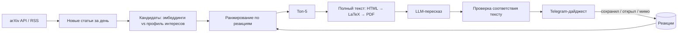

# arxiv-daily-digest

**Персональный дайджест arXiv: каждое утро 5 статей, отобранных под тебя, с пересказами в Telegram.**

> Статус: проектирование. Дизайн-документ — в [`docs/`](docs/).

## Проблема

Только в категории cs.* на arXiv выходят сотни статей в день. Исследователь или инженер не успевает даже пролистать заголовки, поэтому важные работы проходят мимо, а время уходит на ручной разбор лент.

Готовые решения закрывают задачу частично: ленты arXiv не персонализированы, а сервисы рекомендаций не дают проверенного пересказа и не приходят туда, где человек и так читает новости.

## Решение

Бот раз в день:

1. забирает новые статьи из выбранных категорий arXiv;
2. отбирает кандидатов по близости к интересам пользователя;
3. ранжирует их с учётом его прошлых реакций;
4. для топ-5 загружает полный текст и делает короткий пересказ;
5. проверяет, что каждое утверждение пересказа подтверждается текстом статьи;
6. присылает дайджест в Telegram с кнопками «сохранить» и «мимо».

Реакции пользователя становятся метками, на которых учится ранжирование.



## Метрики

| Уровень | Метрика |
| --- | --- |
| Продукт | Доля дайджестов, где сохранена хотя бы одна статья; удержание пользователей по неделям |
| Рекомендации | Precision@5, NDCG@5 по реакциям |
| Пересказ | Доля утверждений, подтверждённых текстом статьи |
| Защитные | Галлюцинации в пересказе; доля статей с испорченным парсингом |
| Система | Стоимость одного дайджеста; время до доставки |

Пороги будут зафиксированы в дизайн-документе до запуска пилота.

## Данные

- **Метаданные статей:** [arXiv API](https://info.arxiv.org/help/api/index.html), RSS по категориям, OAI-PMH. Для офлайн-экспериментов — [датасет метаданных arXiv](https://www.kaggle.com/datasets/Cornell-University/arxiv).
- **Полный текст** (только для топ-5): HTML-версия arXiv, исходники LaTeX, PDF как запасной вариант.
- **Метки:** реакции пользователей в Telegram.
- **Холодный старт:** стартовый опрос интересов или список любимых статей.

## Этапы

- [x] Дизайн-документ: проблема, требования, риски, экономика, метрики
- [x] EDA arXiv и этапы решения задачи (раздел 2.3 дизайн-документа)
- [ ] MVP: сбор статей, ранжирование по эмбеддингам, дайджест в Telegram
- [ ] Пересказы с проверкой соответствия тексту
- [ ] Обучение ранжирования на реакциях, офлайн-оценка
- [ ] Пилот на нескольких пользователях
- [ ] Комиксы по статьям (следующий этап, если позволит экономика)

## Стек (планируемый)

Python 3.13, arXiv API, модель эмбеддингов для текста, PostgreSQL, aiogram для Telegram-бота, LLM через API [BotHub](https://bothub.chat/), Docker, собственный сервер.

Инструменты разработки: [uv](https://docs.astral.sh/uv/) для окружения и зависимостей, [ruff](https://docs.astral.sh/ruff/) как линтер и форматер, [pre-commit](https://pre-commit.com/) для проверок перед коммитом.

## Структура репозитория

```
docs/                     дизайн-документ
src/                      код (появится на этапе MVP)
scripts/                  сбор данных arXiv и разметка gold-набора
notebooks/                EDA, эксперименты и офлайн-оценка
reports/figures/          графики EDA, сохраняются при выполнении ноутбука
data/processed/           производные таблицы EDA (сырые выгрузки в data/raw/ не коммитятся)
data/gold/                gold-набор: выборка статей, разметка, профиль интересов
pyproject.toml            метаданные проекта, зависимости, настройки ruff
uv.lock                   зафиксированные версии зависимостей
.pre-commit-config.yaml   хуки pre-commit
```

## Разработка

Нужен установленный [uv](https://docs.astral.sh/uv/getting-started/installation/).

```bash
git clone https://github.com/neilarphy/arxiv-daily-digest.git
cd arxiv-daily-digest

uv sync
uv tool install pre-commit
pre-commit install
```

Проверки запускаются автоматически при `git commit`. Вручную:

```bash
pre-commit run --all-files
uv run ruff check . --fix
uv run ruff format .
```

### Данные и EDA

```bash
uv sync --group eda
uv run python scripts/collect_arxiv.py meta --last 2026-10-28  # окно EDA: 6 недель, ~15 мин
uv run python scripts/collect_arxiv.py monthly     # объемы по месяцам 2018–2026
uv run python scripts/collect_arxiv.py fulltext    # выборка полных текстов, ~15 мин
uv run python scripts/label_gold.py                # разметка gold-набора в терминале
uv run jupyter nbconvert --to notebook --execute --inplace notebooks/01_eda_arxiv.ipynb
```

Скрипты соблюдают паузу 3 секунды между запросами к arXiv и кэшируют скачанное в `data/raw/`.


## Альтернативы

[alphaXiv](https://www.alphaxiv.org/), [Scholar Inbox](https://www.scholar-inbox.com/), [arxiv-sanity-lite](https://github.com/karpathy/arxiv-sanity-lite). Сравнение и выбор бейзлайна — в дизайн-документе.

## Лицензия

Код — MIT. Метаданные arXiv распространяются по [CC0](https://info.arxiv.org/help/bulk_data.html); права на полные тексты статей принадлежат авторам, поэтому пересказы делаются для личного использования.
