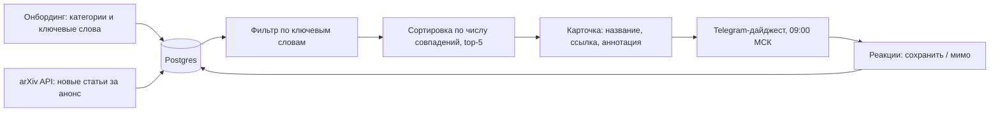
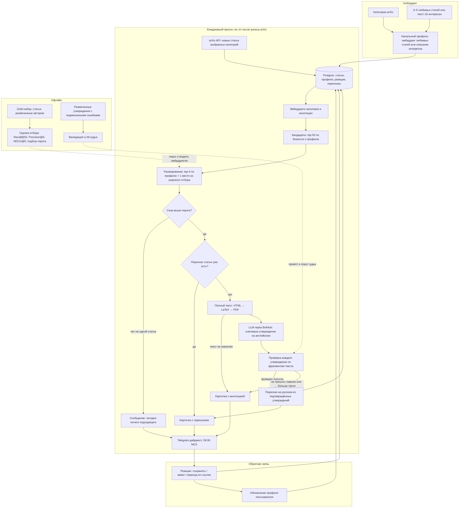

# Дизайн ML-системы: arxiv-daily-digest, MVP, итерация 1

> **Статус:** заполнены разделы 1 и 2.1–2.2. Остальные разделы будут заполнены в следующих итерациях документа.
>
> **Термины**
>
> - **Итерация** — все работы, которые выполняются до старта очередного пилота.
> - **БТ** — бизнес-требования.
> - **EDA** — Exploratory Data Analysis, исследовательский анализ данных.
> - **Дайджест** — ежедневное сообщение в Telegram с 5 рекомендованными статьями.
> - **Gold-набор** — статьи, вручную размеченные автором как релевантные или нет, для офлайн-оценки.

## Содержание

1. [Цели и предпосылки](#1-цели-и-предпосылки)
2. [Методология](#2-методология)
3. [Подготовка пилота](#3-подготовка-пилота)
4. [Внедрение](#4-внедрение)

## 1. Цели и предпосылки

### 1.1. Зачем идём в разработку продукта?

**Бизнес-цель**

Сократить время, которое ML/AI-специалист тратит на отслеживание новых работ на arXiv, и снизить долю пропущенных статей, релевантных его работе.

Пользователи: ML/AI-инженеры, исследователи, магистранты и аспиранты, которые следят за 2–5 категориями по информатике (cs.*, например cs.LG — машинное обучение, cs.CL — NLP, cs.CV — компьютерное зрение). Первый пользователь — я, пилотная группа — 5–10 человек из группы.

Как сейчас: пользователь вручную просматривает листинги arXiv или RSS по категориям, а также подборки в Telegram-каналах и соцсетях.

Проблемы:

- **объём**: в популярных категориях `cs.*` выходят десятки и сотни новых работ в день (точные цифры по выбранным категориям соберу на этапе EDA через arXiv API). Разбор заголовков и аннотаций занимает, по гипотезе, 20–40 минут в день, и это время растёт вместе с потоком статей;
- **пропуски**: в дни, когда разбор ленты пропущен, статьи теряются. Подборки в каналах смещены к популярным работам и не учитывают узкие интересы конкретного человека;
- **первичный разбор**: даже по аннотации не всегда понятно, стоит ли читать статью целиком.

Что изменится: вместо просмотра всей ленты пользователь каждое утро читает 5 карточек с проверенным пересказом и по каждой принимает решение: сохранить, открыть или пропустить. Эффект — сэкономленное время и меньше пропущенных работ. Монетизация возможна при масштабировании, но в эту итерацию не входит.

**Почему с ML станет лучше, чем сейчас**

Аналоги:

| Альтернатива | Чего не хватает |
| --- | --- |
| Ручной просмотр листингов arXiv | Занимает много времени, которое растёт вместе с потоком; дни без разбора выливаются в пропущенные статьи |
| RSS + фильтр по ключевым словам | Не ловит синонимы и смежные формулировки; список слов нужно поддерживать вручную; нет ранжирования, на выходе десятки совпадений без порядка |
| Подборки в Telegram-каналах и соцсетях | Не персонализированы, смещены к популярным работам |
| [arxiv-sanity-lite](https://github.com/karpathy/arxiv-sanity-lite) | Ближайший аналог по механике: рекомендации по тегам пользователя (SVM на tf-idf аннотаций) и ежедневные письма. Нет пересказов; лексические признаки tf-idf не ловят синонимы и смежные формулировки |
| [Scholar Inbox](https://arxiv.org/abs/2504.08385) | Сильный аналог: рекомендации обучаются на оценках пользователя, есть холодный старт и визуальные саммари статей. Отличие проекта — доставка в Telegram, пересказ на русском и проверка каждого утверждения пересказа по тексту статьи |
| [alphaXiv](https://www.alphaxiv.org/) | Ориентирован на работу с литературой: обзоры с опорой на источники, подписки на исследователей, расширение для браузера. Ежедневный персональный дайджест под интересы пользователя среди основных функций не заявлен |

Почему здесь не хватит правила:

- интерес пользователя семантический, а не лексический: одна и та же идея описывается разными словами, а смежные темы ключевыми словами заранее не перечислить;
- интересы меняются со временем. Реакции пользователя дают сигнал, по которому ранжирование подстраивается само, без ручной правки списка слов;
- пересказ и проверку его утверждений по тексту статьи правилом не сделать.

При этом фильтр по ключевым словам берём в качестве бейзлайна. Если у пользователя узкая тема со стабильной терминологией, правило может оказаться достаточным, и MVP должен показать, что даёт прирост сверх него.

**Что будем считать успехом итерации**

Все пороги — гипотезы, уточним на офлайн-оценке и зафиксируем до старта пилота.

- **Целевая метрика**: доля дайджестов, в которых пользователь сохранил хотя бы одну статью, ≥ 50% за пилот (2–4 недели, по готовности MVP), и она выше, чем в дни бейзлайна. Для сравнения дни чередуются: в чётные дайджест собирает MVP, в нечётные — фильтр по ключевым словам; пользователь не знает, какой из них сегодня. 50% при 5 карточках означает, что сохраняют примерно каждую восьмую: 1 − 0,87⁵ ≈ 0,5.
- **Защитные метрики**:
  - доля утверждений в пересказах, не подтверждённых текстом статьи, ≤ 5%;
  - доля пилотных пользователей, отключивших бота, ≤ 20%;
  - время на чтение дайджеста ≤ 10 минут;
  - расходы на LLM ≤ 150 ₽ на пользователя в месяц.

Если максимизировать только долю сохранений, система начнёт слать популярные и громкие статьи вместо релевантных конкретному человеку. Поэтому дополнительно раз в неделю короткий опрос пилотных пользователей: «пропустил ли бот что-то важное?».

### 1.2. Бизнес-требования и ограничения

**Бизнес-требования**

| ID | Требование |
| --- | --- |
| БТ-1 | Онбординг: пользователь выбирает категории arXiv и задаёт интересы одним из способов: 3–5 ссылок на любимые статьи или короткое текстовое описание. Дополнительно — 3–10 ключевых слов, по ним работает бейзлайн |
| БТ-2 | Дайджест приходит в дни публикаций arXiv (пн–пт) до 09:00 МСК и содержит до 5 статей из последнего анонса |
| БТ-3 | Карточка статьи: название, авторы, ссылка на arXiv, пересказ на русском в 3–5 предложениях |
| БТ-4 | В пересказе только утверждения, подтверждённые текстом статьи. Если пересказ не прошёл проверку, вместо него показывается оригинальная аннотация с пометкой |
| БТ-5 | Реакции на карточку: «сохранить» и «мимо»; переход по ссылке тоже фиксируется |
| БТ-6 | Подбор статей учитывает прошлые реакции пользователя |
| БТ-7 | Список сохранённых статей доступен по команде в боте |
| БТ-8 | Пользователь может сменить категории и интересы, поставить дайджест на паузу, отписаться и удалить свои данные |

**Бизнес-ограничения**

| Ограничение | Что из него следует |
| --- | --- |
| Расписание arXiv: новые статьи анонсируются вс–чт в 20:00 по Нью-Йорку, то есть около 03:00–04:00 МСК в пн–пт | Ежедневный прогон стартует после анонса, на сбор, пересказ и проверку остаётся около 5 часов до 09:00 МСК. В сб и вс дайджеста нет |
| Условия arXiv API: не чаще одного запроса раз в 3 секунды | Метаданные забираем пакетно, один раз в день; полные тексты — только для отобранных статей |
| Права на полные тексты принадлежат авторам, метаданные распространяются по CC0 | Полные тексты используем только для пересказа, не публикуем и не распространяем |
| 152-ФЗ: Telegram ID — персональные данные, а реакции становятся ими, пока привязаны к ID | Согласие на обработку в онбординге, храним минимум данных, удаление по команде (БТ-8). Сервер и база находятся в РФ (Timeweb), поэтому требование локализации выполняется. В LLM через BotHub уходят только тексты статей, без данных пользователей |
| Бюджет: собственный сервер уже есть, LLM оплачивается по токенам через BotHub | Основная переменная статья затрат — LLM. Пересказ делается один раз на статью и переиспользуется для всех пользователей, которым она попала в дайджест |
| Команда — один человек | Минимум инфраструктуры: один сервер, Postgres, cron. Поддержка не должна требовать ежедневной ручной работы |

Оценка стоимости дайджеста (гипотеза, уточним на эксперименте с бейзлайном):

- на одну статью: пересказ по полному тексту (~15–30 тыс. входных токенов) + проверка утверждений по фрагментам текста (~10–15 тыс.) ≈ 25–45 тыс. входных токенов и ~1–2 тыс. выходных;
- на дайджест без переиспользования: 5 статей ≈ 125–225 тыс. входных токенов. С переиспользованием пересказов между пользователями стоимость на одного пользователя падает с ростом пилотной группы;
- на пользователя в месяц: ~21 день рассылки × до 225 тыс. ≈ 4,7 млн входных и ~0,2 млн выходных токенов;
- BotHub списывает Caps за каждый токен по тарифу модели, а Caps покупаются пакетами: Basic — 250 ₽ за 1 млн (0,25 ₽ за 1 000 Caps), Deluxe — 1 500 ₽ за 8,5 млн (≈ 0,18 ₽ за 1 000 Caps);
- считаем стоимость **успешного** дайджеста: повторные вызовы и пересказы, не прошедшие проверку, тоже входят в затраты;
- в TCO, кроме токенов, входят сервер (уже есть, предельные затраты около нуля) и время на поддержку.

Расходы на одного пользователя в месяц без переиспользования пересказов, по тарифам BotHub на октябрь 2026 года:

| Модель | Caps за токен, вход / выход | Caps в месяц | ₽ в месяц, пакет Deluxe / Basic |
| --- | --- | --- | --- |
| Qwen3.5 Flash | 0,04 / 0,18 | ~0,22 млн | ~40 / 55 |
| Claude Haiku 5.5 | 0,07 / 0,34 | ~0,40 млн | ~70 / 100 |
| DeepSeek V4 Flash | 0,08 / 0,30 | ~0,44 млн | ~75 / 110 |
| Gemini 2.5 Flash | 0,08 / 0,69 | ~0,51 млн | ~90 / 130 |
| GPT 4.1 Mini | 0,11 / 0,44 | ~0,61 млн | ~105 / 150 |
| Claude Sonnet 5 | 1,13 / 5,65 | ~6,4 млн | ~1 130 / 1 610 |
| GPT 5.2 | 1,21 / 9,65 | ~7,6 млн | ~1 340 / 1 900 |

Дешёвые модели укладываются в порог 150 ₽ на пользователя, модели среднего класса дороже в 7–13 раз. Основные кандидаты для пересказа и проверки — Claude Haiku 5.5 и DeepSeek V4 Flash (~70–110 ₽), выбор между ними — по качеству пересказа на gold-наборе. Запас до порога уходит на повторные вызовы. Пилот на 10 человек — около 4–6 млн Caps в месяц, это один пакет Deluxe (8,5 млн Caps, 1 500 ₽).

**Что ожидаем от итерации**

Работающий MVP для пилотной группы: ежедневный сбор статей, отбор по эмбеддингам с учётом реакций, пересказ с проверкой и доставка в Telegram. Плюс офлайн-оценка отбора на gold-наборе и сравнение с бейзлайном. Обучаемая модель ранжирования в эту итерацию не входит: за 2–4 недели пилота наберётся несколько сотен реакций, этого мало для обучения, но достаточно для оценки и для итерации 2.

**Бизнес-процесс пилота**

1. Пользователь запускает бота, даёт согласие на обработку данных, выбирает категории и интересы (БТ-1).
2. В дни публикаций arXiv в 09:00 МСК приходит дайджест (БТ-2, БТ-3). В чётные дни его собирает MVP, в нечётные — бейзлайн.
3. Пользователь читает карточки и реагирует: сохраняет, открывает или пропускает (БТ-5).
4. Реакции сохраняются и влияют на подбор со следующего дайджеста (БТ-6).
5. Раз в неделю — короткий опрос: сколько времени ушло на дайджест, не пропустил ли бот что-то важное.

Воронка эффекта, где он может теряться: дайджест доставлен → открыт → пересказ прочитан → статья сохранена или открыта. Каждый переход логируем, чтобы понять, где именно теряется эффект: в отборе статей, в качестве пересказа или в том, что пользователь просто не открывает бота.

**Что считаем успешным пилотом**

Условия фиксируем до старта пилота:

| Исход | Условие |
| --- | --- |
| Масштабировать (итерация 2: обучаемое ранжирование, расширение группы до 30–50 человек) | Доля дайджестов с сохранением ≥ 50%, выше бейзлайна; все защитные метрики в пределах порогов |
| Доработать | Доля дайджестов с сохранением 25–50% или нет явной разницы с бейзлайном; защитные метрики в пределах порогов |
| Закрыть | Доля дайджестов с сохранением < 25% и не выше бейзлайна, или доля неподтверждённых утверждений > 15% без способа её снизить, или расходы на LLM больше 300 ₽ на пользователя в месяц (2× порога) |

**Риски**

Вероятность и последствия — экспертная оценка по шкале 1–10, важность = вероятность × последствия.

| Причина | Риск | Эффект | В | П | Важн. | Стратегия |
| --- | --- | --- | --- | --- | --- | --- |
| Пилот маленький, пользователи реагируют редко | Мало реакций для оценки и обучения ранжирования | Нельзя надёжно сравнить с бейзлайном | 7 | 6 | 42 | Mitigate: gold-набор для офлайн-оценки; accept для обучения — оно перенесено в итерацию 2 |
| LLM пересказывает длинный технический текст | Галлюцинации, которые не поймала проверка | Неверные сведения в дайджесте, потеря доверия | 6 | 8 | 48 | Mitigate: проверка каждого утверждения, откат на аннотацию, еженедельный ручной аудит выборки пересказов |
| У части статей нет HTML-версии, PDF парсится с ошибками | Битый или неполный текст статьи | Плохой пересказ или отказ от него | 7 | 5 | 35 | Mitigate: каскад HTML → LaTeX → PDF, проверка качества извлечённого текста, откат на аннотацию |
| BotHub — сторонний агрегатор | Недоступность, рост цен, снятие модели | Дайджест без пересказов или рост стоимости | 4 | 6 | 24 | Mitigate: откат на аннотацию, LLM-клиент через совместимый API, чтобы сменить провайдера конфигом |
| Система показывает только похожее на прошлые реакции | Пузырь интересов, реакции только на узкий круг тем | Пропуск смежных важных работ | 5 | 5 | 25 | Mitigate: одно место в дайджесте под более широкий отбор (см. 2.1) |
| Telegram ID и привязанные к нему реакции — персональные данные | Нарушение 152-ФЗ | Юридические риски | 2 | 7 | 14 | Mitigate: согласие, минимум данных, удаление по запросу, хранение на сервере в РФ, в LLM не передаём данные пользователей |
| Пилотные пользователи бросают бота | Мало данных и смещённая выборка оставшихся | Ненадёжные выводы пилота | 5 | 6 | 30 | Mitigate: набрать 10+ человек, еженедельный опрос, фиксировать причины отписки |
| Задержки анонса или изменения arXiv API | Дайджест опаздывает или не собирается | Пользователь не получает дайджест вовремя | 3 | 4 | 12 | Accept; запасной источник — RSS по категориям |

### 1.3. Что входит в скоуп проекта/итерации, что не входит

**Входит в итерацию**

- БТ-1–БТ-5, БТ-7, БТ-8 полностью.
- БТ-6 частично: профиль пользователя обновляется по реакциям без обучаемой модели (см. 2.1).
- Бейзлайн с фильтром по ключевым словам и его сравнение с MVP.
- Gold-набор автора и офлайн-оценка отбора статей.

**Не входит**

- Обучаемая модель ранжирования по реакциям — итерация 2, когда наберутся данные.
- Комиксы по статьям.
- Веб-интерфейс, другие каналы доставки, кроме Telegram.
- Категории вне `cs.*`, пересказы на других языках, кроме русского.
- Масштабирование больше чем на ~20 пользователей, инфраструктура для A/B-тестов, дашборды мониторинга.
- Монетизация.

**Качество кода и воспроизводимость**

- Линтер и форматер ruff, хуки pre-commit, зафиксированные зависимости в `uv.lock`.
- Тесты на детерминированные части: парсинг arXiv, извлечение текста, отбор и ранжирование.
- Промпты лежат в репозитории и версионируются; названия моделей LLM и эмбеддингов вынесены в конфиг.
- Каждый вызов LLM логируется: версия промпта, модель, токены, стоимость, результат проверки.
- Кандидаты каждого дня сохраняются, чтобы можно было переиграть отбор офлайн на тех же данных.

**Планируемый технический долг**

- Нет мониторинга и алертов, кроме уведомления автору о падении ежедневного прогона.
- Промпты подобраны вручную, без автоматической оптимизации.
- LLM-проверка пересказа валидирована на небольшом наборе, без полноценного аудита судьи.
- Один сервер без резервирования.
- Нет полноценного A/B-теста: на 5–10 пользователях сравнение с бейзлайном показывает направление эффекта, а не его точную величину.

### 1.4. Предпосылки решения

| Предпосылка | Обоснование | Как проверим |
| --- | --- | --- |
| Источник статей — arXiv API, только новые статьи из выбранных категорий `cs.*` | Целевая аудитория — ML/AI-специалисты; метаданные открыты (CC0) | — |
| Частота — раз в сутки, по расписанию анонсов arXiv | Новые статьи появляются раз в сутки; чаще нет смысла | — |
| 5 статей в дайджесте | Укладывается в ~10 минут чтения (защитная метрика из 1.1) | Опрос пилотных пользователей |
| Для отбора хватает эмбеддингов заголовка и аннотации | Аннотация описывает суть статьи; полный текст для всех статей дорог | Recall отбора на gold-наборе |
| Полный текст загружаем только для статей, попавших в дайджест | Затраты на пересказ растут с числом статей, а не с потоком | Доля статей с успешно извлечённым текстом |
| Сигнал интереса — реакция «сохранить»; «мимо» — слабый отрицательный сигнал; отсутствие реакции — не отрицательная метка | «Мимо» может значить «уже читал», а отсутствие реакции — «не открыл бота» | Сравнение реакций с ответами в еженедельном опросе |
| Холодный старт — по 3–5 любимым статьям или текстовому описанию интересов | Content-based подход работает без истории реакций | Доля сохранений в первую неделю у новых пользователей |
| LLM через API (BotHub) | Нагрузка — пара десятков пересказов в день; держать GPU под такую нагрузку невыгодно | Фактическая стоимость дайджеста за месяц пилота |
| Пересказ на русском | Пилотная группа русскоязычная | Опрос |

## 2. Методология

### 2.1. Постановка задачи

С технической точки зрения это **content-based рекомендательная система с генерацией и проверкой текста**. Она состоит из четырёх подзадач.

**1. Отбор кандидатов**

- Объект: новая статья из анонса.
- Вход: эмбеддинг заголовка и аннотации; профиль пользователя — эмбеддинг его интересов.
- Выход: top-50 статей по косинусной близости к профилю.
- Модель: готовая модель эмбеддингов для научных текстов без дообучения. Выбираем на gold-наборе среди 2–3 кандидатов.
- Метрика: Recall@50 на gold-наборе — сколько релевантных статей не потеряли на этом шаге.

**2. Ранжирование и правило отбора**

- Объект: пара «пользователь × статья».
- В итерации 1 обучаемой рекомендательной модели нет. Профиль обновляется по реакциям: эмбеддинги сохранённых статей приближают профиль, «мимо» — немного отдаляет. Оценка статьи будет равняться близости к обновлённому профилю.
- Правило: в дайджест идут top-5 со скором выше порога. Если подходящих меньше пяти, отправляем меньше; если ни одной — короткое сообщение «сегодня ничего подходящего». Порог подбираем на gold-наборе.
- Одно место из пяти отдаём статье из более широкого отбора (top-50, но не top-5), чтобы система не замыкалась на узком круге тем и собирала реакции за пределами текущего профиля.
- Метрики: офлайн — Precision@5 и NDCG@5 на gold-наборе; онлайн — доля дайджестов с сохранением (целевая из 1.1).
- Особенности: каждая статья в дайджесте новая (холодный старт по статьям), поэтому подход content-based. Метки есть только у показанных статей, и реакции зависят от позиции карточки. По этой причине офлайн-оценку делаем на gold-наборе, где размечены все статьи, а не только показанные. Разбиение gold-набора — по дням, а не случайное.

**3. Пересказ**

- Объект: статья из дайджеста.
- Вход: полный текст (HTML → LaTeX → PDF, в порядке приоритета).
- Процесс: LLM выделяет из статьи 5–8 ключевых утверждений на английском (задача, метод, результаты, ограничения) → утверждения проверяются (подзадача 4) → из подтверждённых утверждений собирается пересказ на русском. Так проверка идёт на языке статьи, а в пересказ попадает только проверенное.
- Метрики: доля подтверждённых утверждений; полнота — покрыты ли задача, метод и главный результат (ручная проверка выборки).
- Бейзлайн: оригинальная аннотация.

**4. Проверка утверждений**

- Объект: пара «утверждение × фрагменты текста статьи».
- Выход: подтверждено / не подтверждено.
- Процесс: для утверждения находим релевантные фрагменты текста, LLM-судья решает, следует ли утверждение из них. Неподтверждённые утверждения удаляются; если не подтверждено главное утверждение о результате или больше трети утверждений — показываем аннотацию.
- Валидация судьи: ~100 утверждений, размеченных вручную, включая подмешанные ошибки (неверное число, метод, датасет). Метрики судьи: полнота найденных ошибок и доля ошибок среди принятых утверждений.

**Бейзлайн системы в целом**: фильтр по ключевым словам, которые пользователь задаёт в онбординге, сортировка по числу совпадений, карточка с оригинальной аннотацией. MVP сравниваем с ним по целевой метрике.

### 2.2. Блок-схема решения

Бейзлайн и MVP заметно отличаются, поэтому схем две.

**Бейзлайн**

**MVP**

Этапы работ по итерации: сбор данных и gold-набор → бейзлайн → MVP-отбор и офлайн-оценка → пересказ и валидация судьи → пилот на 2–4 недели → решение по критериям из 1.2.

### 2.3. Этапы решения задачи

*Будет заполнено после EDA.*

## 3. Подготовка пилота

*Будет заполнено в следующих итерациях документа.*

### 3.1. Способ оценки пилота

### 3.2. Что считаем успешным пилотом

### 3.3. Подготовка пилота

## 4. Внедрение

*Будет заполнено в следующих итерациях документа.*

### 4.1. Архитектура решения

### 4.2. Инфраструктура и масштабируемость

### 4.3. Требования к работе системы

### 4.4. Безопасность системы

### 4.5. Безопасность данных

### 4.6. Издержки

### 4.7. Integration points

### 4.8. Риски
