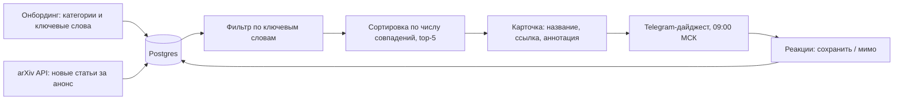
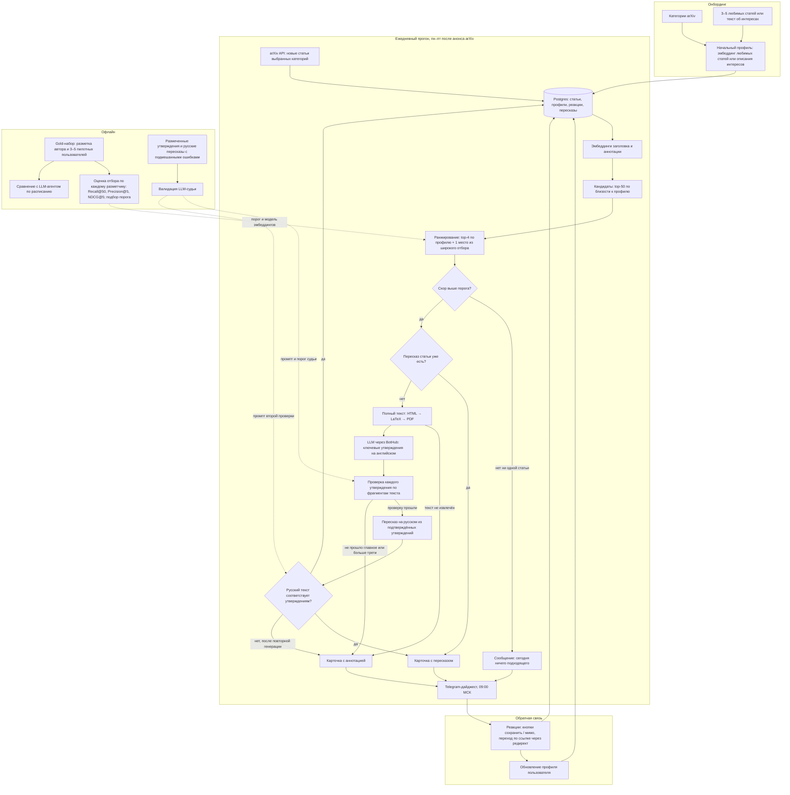

# Дизайн ML-системы: arxiv-daily-digest, MVP, итерация 1

> **Статус:** заполнены разделы 1 и 2, раздел 2.3 опирается на EDA (`notebooks/01_eda_arxiv.ipynb`). Разделы 3 и 4 будут заполнены в следующих итерациях документа.
>
> **Термины**
>
> - **Итерация** — все работы, которые выполняются до старта очередного пилота.
> - **БТ** — бизнес-требования.
> - **EDA** — Exploratory Data Analysis, исследовательский анализ данных.
> - **Дайджест** — ежедневное сообщение в Telegram с 5 рекомендованными статьями.
> - **Gold-набор** — статьи, вручную размеченные автором и несколькими пилотными пользователями как релевантные или нет, для офлайн-оценки.

## Содержание

1. [Цели и предпосылки](#1-цели-и-предпосылки)
2. [Методология](#2-методология)
3. [Подготовка пилота](#3-подготовка-пилота)
4. [Внедрение](#4-внедрение)

## 1. Цели и предпосылки

### 1.1. Зачем идём в разработку продукта?

**Бизнес-цель**

Сократить время, которое ML/AI-специалист тратит на отслеживание новых работ на arXiv, и снизить долю пропущенных статей, релевантных его работе.

Пользователи: ML/AI-инженеры, исследователи, магистранты и аспиранты, которые следят за 2–5 категориями по информатике (cs.*, например cs.LG — машинное обучение, cs.CL — NLP, cs.CV — компьютерное зрение). Первый пользователь — я, пилотная группа — 5–10 человек из группы.

Как сейчас: пользователь вручную просматривает листинги arXiv или RSS по категориям, а также подборки в Telegram-каналах и соцсетях.

Проблемы:

- **объём**: в популярных категориях `cs.*` выходят десятки и сотни новых работ в день (точные цифры по выбранным категориям соберу на этапе EDA через arXiv API). Разбор заголовков и аннотаций занимает, по гипотезе, 20–40 минут в день, и это время растёт вместе с потоком статей;
- **пропуски**: в дни, когда разбор ленты пропущен, статьи теряются. Подборки в каналах смещены к популярным работам и не учитывают узкие интересы конкретного человека;
- **первичный разбор**: даже по аннотации не всегда понятно, стоит ли читать статью целиком.

Оценка в 20–40 минут и сама острота проблемы — гипотезы. Проверим их до пилота коротким опросом 10–20 человек из целевой аудитории: сколько времени в неделю уходит на отслеживание arXiv, как часто важная статья находится с опозданием, готов ли человек доверить первичный отбор боту или ему интересен сам поиск. Если большинство тратит меньше 10 минут в день или не хочет отдавать отбор, целевая аудитория уже, чем предполагаем, и это повод пересмотреть цель до разработки.

Что изменится: вместо просмотра всей ленты пользователь каждое утро читает 5 карточек с проверенным пересказом и по каждой принимает решение: сохранить, открыть или пропустить. Эффект — сэкономленное время и меньше пропущенных работ. Монетизация возможна при масштабировании, но в эту итерацию не входит.

**Почему с ML станет лучше, чем сейчас**

Аналоги:

| Альтернатива | Чего не хватает |
| --- | --- |
| Ручной просмотр листингов arXiv | Занимает много времени, которое растёт вместе с потоком; дни без разбора выливаются в пропущенные статьи |
| RSS + фильтр по ключевым словам | Не ловит синонимы и смежные формулировки; список слов нужно поддерживать вручную; нет ранжирования, на выходе десятки совпадений без порядка |
| Подборки в Telegram-каналах и соцсетях | Не персонализированы, смещены к популярным работам |
| [arxiv-sanity-lite](https://github.com/karpathy/arxiv-sanity-lite) | Ближайший аналог по механике: рекомендации по тегам пользователя (SVM на tf-idf аннотаций) и ежедневные письма. Нет пересказов; лексические признаки tf-idf не ловят синонимы и смежные формулировки |
| [Scholar Inbox](https://arxiv.org/abs/2504.08385) | Сильный аналог: рекомендации обучаются на оценках пользователя, есть холодный старт и визуальные саммари статей. Отличие проекта — доставка в Telegram, пересказ на русском и проверка каждого утверждения пересказа по тексту статьи |
| [alphaXiv](https://www.alphaxiv.org/) | Ориентирован на работу с литературой: обзоры с опорой на источники, подписки на исследователей, расширение для браузера. Ежедневный персональный дайджест под интересы пользователя среди основных функций не заявлен |
| LLM-агент по расписанию (Claude Code или Codex с регулярной задачей и скиллом «найди статьи под мои интересы») | Самая очевидная альтернатива для технического пользователя. Ограничения: реакции не копятся в явный профиль, поэтому отбор не подстраивается системно; утверждения пересказа не проверяются по тексту; результат недетерминирован, его сложно измерить и воспроизвести; каждый пользователь настраивает агента и платит за подписку сам. Явного превосходства по качеству отбора заранее не утверждаем, поэтому включаем агента в офлайн-сравнение на gold-наборе (см. 2.1) |

Почему здесь не хватит правила:

- интерес пользователя семантический, а не лексический: одна и та же идея описывается разными словами, а смежные темы ключевыми словами заранее не перечислить;
- интересы меняются со временем. Реакции пользователя дают сигнал, по которому ранжирование подстраивается само, без ручной правки списка слов;
- пересказ и проверку его утверждений по тексту статьи правилом не сделать.

При этом фильтр по ключевым словам берём в качестве бейзлайна. Если у пользователя узкая тема со стабильной терминологией, правило может оказаться достаточным, и MVP должен показать, что даёт прирост сверх него.

**Что будем считать успехом итерации**

Все пороги — гипотезы, уточним на офлайн-оценке и зафиксируем до старта пилота.

- **Целевая метрика**: доля дайджестов, в которых пользователь сохранил хотя бы одну статью, ≥ 50% за пилот (2–4 недели, по готовности MVP) и выше, чем у бейзлайна, минимум на 10 п. п. 50% при 5 карточках означает, что сохраняют примерно каждую восьмую: 1 − 0,87⁵ ≈ 0,5.
  - Знаменатель — все дни рассылки, включая дни с сообщением «сегодня ничего подходящего»: такой день считается дайджестом без сохранения. Иначе вариант, который чаще ничего не находит, выглядел бы лучше за счёт исключённых дней.
  - Сравнение с бейзлайном: каждый день пилотная группа случайно делится пополам, одна половина получает отбор MVP, другая — отбор бейзлайна, на следующий день половины меняются. Так оба варианта видят одни и те же статьи и одних и тех же людей. Карточки в обоих вариантах одинаковые, с пересказом, поэтому разница приписывается именно отбору. Пользователь не знает, какой вариант получил.
  - Ограничение выводов: на 5–10 пользователях за 2–4 недели наберётся 100–200 дайджестов на вариант, и разница меньше ~10–15 п. п. неотличима от шума. Поэтому пилот показывает направление эффекта, а не его точную величину, а минимальный полезный эффект задан как +10 п. п. к бейзлайну.
- **Защитные метрики**:
  - доля утверждений в пересказах, не подтверждённых текстом статьи, ≤ 5% (ручной аудит выборки итоговых русских пересказов);
  - доля пилотных пользователей, отключивших бота, ≤ 20%;
  - время на дайджест, включая чтение и проверку пересказов, ≤ 10 минут и меньше, чем текущий способ по опросу до пилота;
  - доля дней с сообщением «сегодня ничего подходящего» ≤ 20%;
  - расходы на LLM ≤ 150 ₽ на пользователя в месяц.

Сохранение — прокси пользы, а не сама польза: пользователь может сохранять «на потом» и не читать, или сохранить одну статью и пропустить более важную. Если максимизировать только долю сохранений, система начнёт слать популярные и громкие статьи вместо релевантных конкретному человеку. Поэтому две бизнес-цели из начала раздела измеряем напрямую в коротком еженедельном опросе:

- **время**: сколько минут в неделю ушло на отслеживание статей с ботом, в сравнении с ответом из опроса до пилота;
- **пропуски**: «была ли на этой неделе важная для вас статья, которую бот не показал?» и «прочитали ли вы что-то из сохранённого?».

Офлайн пропуски оцениваем по Recall на gold-наборе (см. 2.1).

### 1.2. Бизнес-требования и ограничения

**Бизнес-требования**

| ID | Требование |
| --- | --- |
| БТ-1 | Онбординг: пользователь выбирает категории arXiv и задаёт интересы одним из способов: 3–5 ссылок на любимые статьи или короткое текстовое описание. Дополнительно — 3–10 ключевых слов, по ним работает бейзлайн |
| БТ-2 | Дайджест приходит в дни публикаций arXiv (пн–пт) до 09:00 МСК и содержит до 5 статей из последнего анонса |
| БТ-3 | Карточка статьи: название, авторы, ссылка на arXiv, пересказ на русском в 3–5 предложениях |
| БТ-4 | В пересказе только утверждения, подтверждённые текстом статьи. Если пересказ не прошёл проверку, вместо него показывается оригинальная аннотация с пометкой |
| БТ-5 | Реакции на карточку: кнопки «сохранить» и «мимо». Переход по ссылке на статью фиксируется через редирект на нашем сервере: Telegram не сообщает боту о нажатии URL-кнопки |
| БТ-6 | Подбор статей учитывает прошлые реакции пользователя |
| БТ-7 | Список сохранённых статей доступен по команде в боте |
| БТ-8 | Пользователь может сменить категории и интересы, поставить дайджест на паузу, отписаться и удалить свои данные |

**Бизнес-ограничения**

| Ограничение | Что из него следует |
| --- | --- |
| Расписание arXiv: новые статьи анонсируются вс–чт в 20:00 по Нью-Йорку, то есть около 03:00–04:00 МСК в пн–пт | Ежедневный прогон стартует после анонса, на сбор, пересказ и проверку остаётся около 5 часов до 09:00 МСК. В сб и вс дайджеста нет |
| Условия arXiv API: не чаще одного запроса раз в 3 секунды | Метаданные забираем пакетно, один раз в день; полные тексты — только для отобранных статей |
| Права на полные тексты принадлежат авторам, метаданные распространяются по CC0 | Полные тексты используем только для пересказа, не публикуем и не распространяем |
| 152-ФЗ: Telegram ID — персональные данные, а реакции становятся ими, пока привязаны к ID | Согласие на обработку в онбординге, храним минимум данных, удаление по команде (БТ-8). Сервер и база находятся в РФ (Timeweb), поэтому требование локализации выполняется. В LLM через BotHub уходят только тексты статей, без данных пользователей |
| Бюджет: собственный сервер уже есть, LLM оплачивается по токенам через BotHub | Основная переменная статья затрат — LLM. Пересказ делается один раз на статью и переиспользуется для всех пользователей, которым она попала в дайджест |
| Команда — один человек | Минимум инфраструктуры: один сервер, Postgres, cron. Поддержка не должна требовать ежедневной ручной работы |

Оценка стоимости дайджеста (гипотеза, уточним на эксперименте с бейзлайном):

- на одну статью: пересказ по полному тексту (~15–30 тыс. входных токенов) + проверка утверждений по фрагментам текста (~10–15 тыс.) ≈ 25–45 тыс. входных токенов и ~1–2 тыс. выходных;
- на дайджест без переиспользования: 5 статей ≈ 125–225 тыс. входных токенов. С переиспользованием пересказов между пользователями стоимость на одного пользователя падает с ростом пилотной группы;
- на пользователя в месяц: ~21 день рассылки × до 225 тыс. ≈ 4,7 млн входных и ~0,2 млн выходных токенов;
- BotHub списывает Caps за каждый токен по тарифу модели, а Caps покупаются пакетами: Basic — 250 ₽ за 1 млн (0,25 ₽ за 1 000 Caps), Deluxe — 1 500 ₽ за 8,5 млн (≈ 0,18 ₽ за 1 000 Caps);
- считаем стоимость **успешного** дайджеста: повторные вызовы и пересказы, не прошедшие проверку, тоже входят в затраты;
- в TCO, кроме токенов, входят сервер (уже есть, предельные затраты около нуля) и время людей, оценка ниже.

Трудозатраты на итерацию (грубая оценка):

| Работа | Кто | Часы |
| --- | --- | --- |
| Разработка MVP и бейзлайна | Автор | 60–80 |
| Разметка gold-набора | Автор и 3–5 пилотных пользователей | ~3 у автора, ~0,5 у каждого пользователя |
| Разметка ~100 утверждений для валидации судьи | Автор | ~3 |
| Ручной аудит выборки пересказов | Автор | ~1 в неделю |
| Поддержка и разбор сбоев | Автор | ~1 в неделю |

Оценка нужна для решения о масштабировании: при росте группы до 30–50 человек разметка и аудит не должны расти пропорционально числу пользователей.

Расходы на одного пользователя в месяц без переиспользования пересказов, по тарифам BotHub на октябрь 2026 года:

| Модель | Caps за токен, вход / выход | Caps в месяц | ₽ в месяц, пакет Deluxe / Basic |
| --- | --- | --- | --- |
| Qwen3.5 Flash | 0,04 / 0,18 | ~0,22 млн | ~40 / 55 |
| Claude Haiku 5.5 | 0,07 / 0,34 | ~0,40 млн | ~70 / 100 |
| DeepSeek V4 Flash | 0,08 / 0,30 | ~0,44 млн | ~75 / 110 |
| Gemini 2.5 Flash | 0,08 / 0,69 | ~0,51 млн | ~90 / 130 |
| GPT 4.1 Mini | 0,11 / 0,44 | ~0,61 млн | ~105 / 150 |
| Claude Sonnet 5 | 1,13 / 5,65 | ~6,4 млн | ~1 130 / 1 610 |
| GPT 5.2 | 1,21 / 9,65 | ~7,6 млн | ~1 340 / 1 900 |

Дешёвые модели укладываются в порог 150 ₽ на пользователя, модели среднего класса дороже в 7–13 раз. Основные кандидаты для пересказа и проверки — Claude Haiku 5.5 и DeepSeek V4 Flash (~70–110 ₽), выбор между ними — по качеству пересказа на gold-наборе. Запас до порога уходит на повторные вызовы. Пилот на 10 человек — около 4–6 млн Caps в месяц, это один пакет Deluxe (8,5 млн Caps, 1 500 ₽).

Уточнение по EDA (см. 2.3, этап 3): основной текст статьи без списка литературы и приложений короче, чем закладывали, – медиана ~10,5 тыс. токенов. С обеими проверками выходит ~23 тыс. входных токенов на статью и ~45 ₽ на пользователя в месяц для Claude Haiku 5.5 и DeepSeek V4 Flash (до ~60 ₽ по 90-му перцентилю). Таблица выше остается верхней оценкой.

**Что ожидаем от итерации**

Работающий MVP для пилотной группы: ежедневный сбор статей, отбор по эмбеддингам с учётом реакций, пересказ с проверкой и доставка в Telegram. Плюс офлайн-оценка отбора на gold-наборе и сравнение с бейзлайном. Обучаемая модель ранжирования в эту итерацию не входит: за 2–4 недели пилота наберётся несколько сотен реакций, этого мало для обучения, но достаточно для оценки и для итерации 2.

**Бизнес-процесс пилота**

0. До пилота — опрос о текущем процессе: время на отслеживание статей, частота пропусков (см. 1.1).
1. Пользователь запускает бота, даёт согласие на обработку данных, выбирает категории и интересы (БТ-1).
2. В дни публикаций arXiv в 09:00 МСК приходит дайджест (БТ-2, БТ-3). Его собирает MVP или бейзлайн: каждый день группа случайно делится пополам, на следующий день половины меняются (см. 1.1).
3. Пользователь читает карточки и реагирует: сохраняет, открывает или пропускает (БТ-5).
4. Реакции сохраняются и влияют на подбор со следующего дайджеста (БТ-6).
5. Раз в неделю — короткий опрос: сколько времени ушло на статьи, не пропустил ли бот что-то важное, прочитано ли что-то из сохранённого.

Воронка эффекта строится только по событиям, которые бот действительно видит. Bot API не сообщает об открытии и прочтении сообщения, поэтому этапы такие: дайджест доставлен (успешная отправка) → есть хотя бы одна реакция на карточки (callback-кнопки) → статья сохранена или открыта по ссылке (редирект, БТ-5). Дайджест без реакций не отличить от непрочитанного, поэтому вопрос «читаете ли вы дайджест» добавлен в еженедельный опрос. Так видно, где теряется эффект: в доставке, в том, что пользователь не реагирует, или в отборе статей.

**Что считаем успешным пилотом**

Условия фиксируем до старта пилота. Строки проверяются сверху вниз, первая подошедшая определяет исход, так что любой результат попадает ровно в один исход:

| Исход | Условие |
| --- | --- |
| Закрыть | Доля дайджестов с сохранением < 25% и не выше бейзлайна, или доля неподтверждённых утверждений > 15% без способа её снизить, или расходы на LLM больше 300 ₽ на пользователя в месяц (2× порога) |
| Масштабировать (итерация 2: обучаемое ранжирование, расширение группы до 30–50 человек) | Доля дайджестов с сохранением ≥ 50% и выше бейзлайна минимум на 10 п. п.; все защитные метрики в пределах порогов |
| Доработать | Все остальные случаи. Например: доля сохранений 25–50%; нет разницы с бейзлайном; цель достигнута, но одна из защитных метрик за порогом (скажем, расходы получаются сильно больше планируемых на 1 пользователя) |

**Риски**

Вероятность и последствия — экспертная оценка по шкале 1–10, важность = вероятность × последствия.

| Причина | Риск | Эффект | В | П | Важн. | Стратегия |
| --- | --- | --- | --- | --- | --- | --- |
| Пилот маленький, пользователи реагируют редко | Мало реакций для оценки и обучения ранжирования | Нельзя надёжно сравнить с бейзлайном | 7 | 6 | 42 | Mitigate: gold-набор для офлайн-оценки; accept для обучения — оно перенесено в итерацию 2 |
| LLM пересказывает длинный технический текст | Галлюцинации, которые не поймала проверка | Неверные сведения в дайджесте, потеря доверия | 6 | 8 | 48 | Mitigate: проверка каждого утверждения, откат на аннотацию, еженедельный ручной аудит выборки пересказов |
| У части статей нет HTML-версии, PDF парсится с ошибками | Битый или неполный текст статьи | Плохой пересказ или отказ от него | 7 | 5 | 35 | Mitigate: каскад HTML → LaTeX → PDF, проверка качества извлечённого текста, откат на аннотацию |
| BotHub — сторонний агрегатор | Недоступность, рост цен, снятие модели | Дайджест без пересказов или рост стоимости | 4 | 6 | 24 | Mitigate: откат на аннотацию, LLM-клиент через совместимый API, чтобы сменить провайдера конфигом |
| Система показывает только похожее на прошлые реакции | Пузырь интересов, реакции только на узкий круг тем | Пропуск смежных важных работ | 5 | 5 | 25 | Mitigate: одно место в дайджесте под более широкий отбор (см. 2.1) |
| Telegram ID и привязанные к нему реакции — персональные данные | Нарушение 152-ФЗ | Юридические риски | 2 | 7 | 14 | Mitigate: согласие, минимум данных, удаление по запросу, хранение на сервере в РФ, в LLM не передаём данные пользователей |
| Пилотные пользователи бросают бота | Мало данных и смещённая выборка оставшихся | Ненадёжные выводы пилота | 5 | 6 | 30 | Mitigate: набрать 10+ человек, еженедельный опрос, фиксировать причины отписки |
| Задержки анонса или изменения arXiv API | Дайджест опаздывает или не собирается | Пользователь не получает дайджест вовремя | 3 | 4 | 12 | Accept; запасной источник — RSS по категориям |

### 1.3. Что входит в скоуп проекта/итерации, что не входит

**Входит в итерацию**

- БТ-1–БТ-5, БТ-7, БТ-8 полностью.
- БТ-6 частично: профиль пользователя обновляется по реакциям без обучаемой модели (см. 2.1).
- Бейзлайн с фильтром по ключевым словам и его сравнение с MVP.
- Gold-набор: разметка автора и 3–5 пилотных пользователей, офлайн-оценка отбора статей для каждого из них.
- Офлайн-сравнение с LLM-агентом по расписанию на gold-наборе.
- Опрос о текущем процессе до пилота и еженедельный опрос во время пилота.

**Не входит**

- Обучаемая модель ранжирования по реакциям — итерация 2, когда наберутся данные.
- Комиксы по статьям.
- Веб-интерфейс, другие каналы доставки, кроме Telegram.
- Категории вне `cs.*`, пересказы на других языках, кроме русского.
- Масштабирование больше чем на ~20 пользователей, инфраструктура для A/B-тестов, дашборды мониторинга.
- Монетизация.

**Качество кода и воспроизводимость**

- Линтер и форматер ruff, хуки pre-commit, зафиксированные зависимости в `uv.lock`.
- Тесты на детерминированные части: парсинг arXiv, извлечение текста, отбор и ранжирование.
- Промпты лежат в репозитории и версионируются; названия моделей LLM и эмбеддингов вынесены в конфиг.
- Каждый вызов LLM логируется: версия промпта, модель, токены, стоимость, результат проверки.
- Кандидаты каждого дня сохраняются, чтобы можно было переиграть отбор офлайн на тех же данных.

**Планируемый технический долг**

- Нет мониторинга и алертов, кроме уведомления автору о падении ежедневного прогона.
- Промпты подобраны вручную, без автоматической оптимизации.
- LLM-проверка пересказа валидирована на небольшом наборе, без полноценного аудита судьи.
- Один сервер без резервирования.
- Нет полноценного A/B-теста: на 5–10 пользователях сравнение с бейзлайном показывает направление эффекта, а не его точную величину (см. 1.1).
- Gold-набор покрывает интересы автора и нескольких пилотных пользователей. После пилота его стоит пересобрать с учётом реакций из логов, помня, что в логах есть реакции только на показанные статьи.

### 1.4. Предпосылки решения

| Предпосылка | Обоснование | Как проверим |
| --- | --- | --- |
| Отслеживание arXiv занимает у целевой аудитории 20–40 минут в день (по предположениям), и люди хотят сократить это время | Опыт автора и разговоры в группе; часть людей может ценить сам процесс поиска, это не целевая аудитория | Опрос 10–20 человек до пилота (см. 1.1) |
| Сохранение статьи — прокси пользы | Сохраняют то, что хотят прочитать; но сохранённое могут и не прочитать | Вопрос «прочитали ли вы что-то из сохранённого» в еженедельном опросе |
| Источник статей — arXiv API, только новые статьи из выбранных категорий `cs.*` | Целевая аудитория — ML/AI-специалисты; метаданные открыты (CC0) | — |
| Частота — раз в сутки, по расписанию анонсов arXiv | Новые статьи появляются раз в сутки; чаще нет смысла | — |
| 5 статей в дайджесте | Укладывается в ~10 минут чтения (защитная метрика из 1.1) | Опрос пилотных пользователей |
| Для отбора хватает эмбеддингов заголовка и аннотации | Аннотация описывает суть статьи; полный текст для всех статей дорог | Recall отбора на gold-наборе |
| Полный текст загружаем только для статей, попавших в дайджест | Затраты на пересказ растут с числом статей, а не с потоком | Доля статей с успешно извлечённым текстом |
| Сигнал интереса — реакция «сохранить»; «мимо» — слабый отрицательный сигнал; отсутствие реакции — не отрицательная метка | «Мимо» может значить «уже читал», а отсутствие реакции — «не открыл бота» | Сравнение реакций с ответами в еженедельном опросе |
| Холодный старт — по 3–5 любимым статьям или текстовому описанию интересов | Content-based подход работает без истории реакций | Доля сохранений в первую неделю у новых пользователей |
| LLM через API (BotHub) | Нагрузка — пара десятков пересказов в день; держать GPU под такую нагрузку невыгодно | Фактическая стоимость дайджеста за месяц пилота |
| Пересказ на русском | Пилотная группа русскоязычная | Опрос |

## 2. Методология

### 2.1. Постановка задачи

С технической точки зрения это **content-based рекомендательная система с генерацией и проверкой текста**. Она состоит из четырёх подзадач.

**1. Отбор кандидатов**

- Объект: новая статья из анонса.
- Вход: эмбеддинг заголовка и аннотации; профиль пользователя — эмбеддинг его интересов.
- Выход: top-50 статей по косинусной близости к профилю.
- Модель: готовая модель эмбеддингов для научных текстов без дообучения. Выбираем на gold-наборе среди 2–3 кандидатов.
- Метрика: Recall@50 на gold-наборе — сколько релевантных статей не потеряли на этом шаге.

**2. Ранжирование и правило отбора**

- Объект: пара «пользователь × статья».
- В итерации 1 обучаемой рекомендательной модели нет. Профиль обновляется по реакциям: эмбеддинги сохранённых статей приближают профиль, «мимо» — немного отдаляет. Оценка статьи будет равняться близости к обновлённому профилю.
- Правило: в дайджест идут top-5 со скором выше порога. Если подходящих меньше пяти, отправляем меньше; если ни одной — короткое сообщение «сегодня ничего подходящего». Порог подбираем на gold-наборе.
- Одно место из пяти отдаём статье из более широкого отбора (top-50, но не top-5), чтобы система не замыкалась на узком круге тем и собирала реакции за пределами текущего профиля.
- Метрики: офлайн — Precision@5 и NDCG@5 на gold-наборе; онлайн — доля дайджестов с сохранением (целевая из 1.1).
- Особенности: каждая статья в дайджесте новая (холодный старт по статьям), поэтому подход content-based. Метки есть только у показанных статей, и реакции зависят от позиции карточки. По этой причине офлайн-оценку делаем на gold-наборе, где размечены все статьи, а не только показанные. Разбиение gold-набора — по дням, а не случайное.
- Gold-набор: автор и 3–5 пилотных пользователей размечают каждый по ~50 статей из одного-двух анонсов своих категорий, все подряд, а не только отобранные системой. Метрики считаем по каждому разметчику отдельно, чтобы оценивать персонализацию, а не вкус автора.

**3. Пересказ**

- Объект: статья из дайджеста.
- Вход: полный текст (HTML → LaTeX → PDF, в порядке приоритета).
- Процесс: LLM выделяет из статьи 5–8 ключевых утверждений на английском (задача, метод, результаты, ограничения) → утверждения проверяются по тексту статьи (подзадача 4) → из подтверждённых утверждений собирается пересказ на русском → русский пересказ сверяется с подтверждёнными утверждениями. Так проверка по статье идёт на её языке, а вторая проверка ловит искажения при генерации русского текста: потерянные оговорки, неверные числа, лишние выводы.
- Метрики: доля подтверждённых утверждений; полнота — покрыты ли задача, метод и главный результат (ручная проверка выборки).
- Бейзлайн: оригинальная аннотация.

**4. Проверка утверждений**

- Объект: пара «утверждение × фрагменты текста статьи».
- Выход: подтверждено / не подтверждено.
- Процесс: для утверждения находим релевантные фрагменты текста, LLM-судья решает, следует ли утверждение из них. Неподтверждённые утверждения удаляются; если не подтверждено главное утверждение о результате или больше трети утверждений — показываем аннотацию.
- Вторая проверка: каждое предложение русского пересказа сверяется с подтверждёнными английскими утверждениями. Контекст короткий, ~2 тыс. токенов, поэтому проверка дешёвая. Если предложение не подтверждается, пересказ генерируется заново один раз, после второй неудачи показываем аннотацию.
- Валидация судьи: ~100 утверждений, размеченных вручную, включая подмешанные ошибки (неверное число, метод, датасет), плюс ~30 русских пересказов с подмешанными искажениями для второй проверки. Метрики судьи: полнота найденных ошибок и доля ошибок среди принятых утверждений.

**Бейзлайн системы в целом**: фильтр по ключевым словам, которые пользователь задаёт в онбординге, сортировка по числу совпадений, карточка с оригинальной аннотацией. MVP сравниваем с ним по целевой метрике.

**Дополнительное офлайн-сравнение**: LLM-агент по расписанию (см. альтернативы в 1.1). На тех же днях gold-набора агенту дают интересы пользователя и список статей анонса, просят выбрать 5. Сравниваем Precision@5, NDCG@5 и стоимость. Если агент не хуже по качеству и дешевле, это аргумент упростить архитектуру отбора.

### 2.2. Блок-схема решения

Бейзлайн и MVP заметно отличаются, поэтому схем две.

**Бейзлайн**

**MVP**

Этапы работ по итерации: опрос о текущем процессе → сбор данных и gold-набор → бейзлайн → MVP-отбор и офлайн-оценка → пересказ и валидация судьи → пилот на 2–4 недели → решение по критериям из 1.2.

### 2.3. Этапы решения задачи

Цифры ниже – из EDA: `notebooks/01_eda_arxiv.ipynb`, данные собирает `scripts/collect_arxiv.py`, gold-набор размечается в `scripts/label_gold.py`. Окно EDA – 6 недель подачи (17.09–28.10.2026), снимок arXiv API на 01.11.2026, категории cs.LG и cs.AI.

Этапы и их связь со схемой из 2.2:

| Этап | Что делаем | Бейзлайн | MVP |
| --- | --- | --- | --- |
| 1. Подготовка данных | Сбор статей, полных текстов, gold-набора, профилей | Метаданные и ключевые слова | То же плюс полные тексты и любимые статьи |
| 2. Модель отбора | Кандидаты, ранжирование, порог | Число совпадений ключевых слов | Косинус эмбеддингов к профилю |
| 3. Извлечение полного текста | HTML → LaTeX → PDF | Не нужен | Каскад с проверкой качества |
| 4. Пересказ и две проверки | Утверждения, проверка, русский текст, вторая проверка | Оригинальная аннотация | Проверенный пересказ |
| 5. Валидация LLM-судьи | Подбор промпта и порога судьи | Не нужна | Размеченные утверждения и пересказы |
| 6. Правило отбора, бюджет, подготовка пилота | Порог, место для широкого отбора, лимиты расходов, логирование | Top-5 по совпадениям | Top-4 + 1 из широкого отбора, выше порога |

#### Этап 1. Подготовка данных

**Данные и сущности**

| Данные | Есть ли сейчас | Откуда и как получаем | Качество проверено |
| --- | --- | --- | --- |
| Метаданные статей: id, версия, заголовок, аннотация, авторы, категории, даты, comment | Да, 16 030 статей за 6 недель | arXiv API, CC0; в продакшене – ежедневная лента анонса (RSS или OAI-PMH) | Да, EDA разделы 1–2 |
| Месячные объемы 2018–2026 | Да | arXiv API, только `totalResults` | Да, сверены с дневными выгрузками за октябрь |
| Полные тексты: HTML (LaTeXML), LaTeX-исходник, PDF | Да, выборка 100 статей | arxiv.org, права у авторов: используем только для пересказа, не публикуем | Да, EDA раздел 3 |
| Профиль: любимые статьи, описание интересов, ключевые слова (БТ-1) | У автора | Онбординг в боте; заголовки и аннотации любимых статей – из arXiv API по id | Проверяем, что все id нашлись в arXiv |
| Gold-набор | Выборка 200 статей за 26–27.10 зафиксирована; на этой итерации размечена «серебряной» разметкой LLM по синтетическому профилю (6 релевантных, 8 пограничных) для отладки офлайн-оценки | `scripts/label_gold.py`; ручная разметка: автор – те же 200 статей, пилотные пользователи – по ~50 | Доля релевантных – EDA раздел 4 |
| Реакции: сохранить, мимо, переход по ссылке | Нет | Пилот, кнопки бота и редирект (БТ-5) | В пилоте: доля дайджестов без реакций, дубликаты нажатий |
| Размеченные утверждения и русские пересказы с подмешанными ошибками | Нет | Ручная разметка автора, ~3 ч (см. 1.2) | Этап 5 |
| Ответы на опросы | Нет | Опрос до пилота и еженедельный во время пилота | – |

Основные сущности: **статья** (id без версии – ключ дедупликации; версия; категории; пакет анонса), **пакет анонса** (дата анонса и список статей – пул кандидатов дня), **пользователь** (Telegram ID, категории, профиль), **показ** (пользователь × статья × дата × позиция × вариант MVP или бейзлайн), **реакция** (показ × тип × время), **пересказ** (статья × версия промпта × модель × утверждения × вердикты × стоимость).

**Как генерируются данные.** Авторы подают статьи в arXiv, модераторы проверяют категорию. Каждый будний день анонс (вс–чт, 20:00 по Нью-Йорку) публикует все, что подано до 14:00 предыдущего рабочего дня: новые статьи, cross-list из других категорий и замены версий. Поэтому дайджест строится по пакету анонса, а не по дате подачи: понедельничный пакет включает пятницу и выходные. Search API отстает от анонса примерно на 3 дня (статьи последних дней в нем еще не видны), поэтому в продакшене источник – лента анонса, а API – для истории и EDA. Формат ленты проверяем на этапе разработки: в выходные она пустая.

**Что показал EDA: проблемы и риски данных**

| Наблюдение | Цифры | Что делаем |
| --- | --- | --- |
| Пул кандидатов большой и неровный | Медиана пакета ~490 статей, понедельник ~840, пик 28–30.09 – до 856 в день подачи | Отбор и бюджет рассчитываем на пул до ~1 000 статей; эмбеддинг на CPU – ~0,14 с на статью (bge-small), понедельник ~2 мин |
| Поток быстро растет и сезонен | В 2026 году в 7,7 раза больше статей, чем в 2018-м, +35% к 2025-му; пики в мае (NeurIPS) и сентябре | Пересматриваем бюджет и время прогона раз в полгода |
| 41% пула – cross-list из других категорий | cs.CV 8%, cs.CL 7%, cs.RO 4%, stat.ML 4% | Источник шума и релевантных статей одновременно; gold-набор пилотных пользователей берем из всего пула |
| cs.LG и cs.AI пересекаются слабо | В обеих категориях 18% статей | Выбор двух категорий почти удваивает пул |
| Статьи обновляются | 12% уже в версии 2+ | Дедупликация по id без версии, повторно не отправляем |
| LaTeX в аннотациях | `$…$` у 18%, команды у 15% | Для эмбеддингов терпимо; в карточке бейзлайна упрощаем формулы до Unicode |
| `journal_ref`, DOI почти пусты | Пусты у 98%; comment – у 51% | Признаки площадки в итерации 1 не используем |
| Полный текст доступен почти всегда | HTML 94%, LaTeX 97%, PDF 100% (источники пересекаются); по каскаду текст из HTML у 92%, из LaTeX у 5%, из PDF у 3%; ошибки LaTeXML у 6% | Каскад HTML → LaTeX → PDF с проверкой ошибок (этап 3) |
| Больше половины текста – литература и приложения | PDF целиком – медиана 21 тыс. токенов, основной текст – 10,5 тыс. | Режем литературу и приложения, лимит 30 тыс.; расходы ~45 ₽ на пользователя в месяц (см. 1.2) |
| arXiv API нестабилен | Во время сбора – ответы 429 и 500, `max_results=0` дает ошибку с правдоподобным числом в ответе | Проверяем статус и структуру каждого ответа, повторы с паузой, сбор возобновляемый |

**Если данных не хватает**

- Gold-набор: если у разметчика меньше 10 релевантных статей, метрики top-5 слишком шумные. Тогда досэмплируем статьи с высоким скором бейзлайна и эмбеддингов (обогащение положительными) и учитываем это весами в метриках. Дополнительно можно разметить больше статей «серебряной» разметкой LLM по профилю и проверить ее согласие с ручной разметкой на gold-наборе.
- Реакции: в пилоте их будет несколько сотен, для обучения мало. Поэтому в итерации 1 обучения нет, реакции идут в оценку и в обновление профиля (см. этап 2).
- Профиль: если у пользователя нет любимых статей, профиль строим по описанию интересов, а первые реакции быстро его уточняют.

**Конфиденциальные данные.** Telegram ID и привязанные к нему реакции и профиль – персональные данные (см. 1.2, 152-ФЗ): храним на сервере в РФ, в LLM не передаем. Gold-наборы пилотных пользователей кладем в репозиторий только с их согласия и под псевдонимом (`gold_u1.csv`). Полные тексты статей не коммитим и не распространяем: сырые выгрузки лежат в `data/raw/`, он в `.gitignore`.

**Результат этапа**: скрипты сбора и разметки, ноутбук EDA, производные таблицы в `data/processed/`, выборка gold-набора и «серебряная» разметка в `data/gold/`, схема данных для продакшена (сущности выше). До пилота остается ручная разметка автора и 3–5 пилотных пользователей.

#### Этап 2. Подготовка модели отбора

**Метрики**

| Метрика | Шаг | Почему она |
| --- | --- | --- |
| Recall@50 | Кандидаты | Статью, потерянную на этом шаге, ранжирование уже не вернет |
| Precision@5 | Дайджест | Пользователь видит ровно 5 карточек, важна доля релевантных среди них |
| NDCG@5 | Дайджест | Учитывает порядок: верхние карточки читают чаще |
| HitRate@5 – доля дней, когда в top-5 есть хотя бы одна релевантная | Дайджест | Офлайн-прокси целевой метрики «доля дайджестов с сохранением» из 1.1 |

Метрики считаем по каждому дню отдельно (в продакшене ранжируем только пул дня) и по каждому разметчику отдельно, затем усредняем. «Не уверен» считаем нерелевантным, это консервативная оценка.

**Функция потерь.** В итерации 1 модель не обучается: скор – косинус между эмбеддингом статьи и профилем пользователя. Подбираем только модель эмбеддингов, способ собрать профиль из описания интересов и любимых статей и порог. В итерации 2, когда накопятся реакции, – обучаемое ранжирование с попарной функцией потерь (BPR или логистическая на парах «сохраненная – показанная, но не сохраненная»): нам важен порядок внутри дня, а не откалиброванная вероятность. Реакции зависят от позиции карточки, поэтому в обучении нужна поправка на позицию (взвешивание по обратной вероятности показа).

**Схема валидации.** Разбиение по дням, не случайное: модель и порог выбираем на одном дне, проверяем на другом, затем меняем дни местами. Для пилотных пользователей – по их дням, оставляя один день на проверку. Гиперпараметров мало (модель, агрегация, порог), поэтому риск переобучения на маленьком наборе ограничен, но доверительные интервалы считаем бутстрепом по статьям внутри дня и показываем вместе с метриками. При 200 статьях и двух днях разница меньше ~0,1–0,2 по Precision@5 неотличима от шума.

**Бейзлайн**: число ключевых слов пользователя в заголовке и аннотации, без учета регистра; ничьи разбиваются случайно. Нижняя граница – случайный порядок: его Precision@5 равен доле релевантных в пуле.

**MVP**: эмбеддинги заголовка и аннотации готовой моделью без дообучения. Кандидаты из EDA: `bge-small-en-v1.5`, `bge-base-en-v1.5`, `all-MiniLM-L6-v2` (через `fastembed`, ONNX на CPU). Аннотация помещается в окно 512 токенов у 99,8% статей, поэтому чанкование не нужно. Выбор – по NDCG@5 и Recall@50, при близком качестве берем более быструю модель: на CPU bge-base в 2,5 раза медленнее bge-small, MiniLM в 5 раз быстрее.

**Первые результаты** (ноутбук, раздел 5; «серебряная» разметка, 2 дня, 6 релевантных статей – проверка направления, а не окончательный выбор):

| Отбор | Recall@50 | Precision@5 | NDCG@5 | HitRate@5 |
| --- | --- | --- | --- | --- |
| Случайный порядок | 0,46 | 0,03 | 0,05 | 0,14 |
| Бейзлайн: ключевые слова | 1,00 | 0,30 | 0,62 | 1,00 |
| bge-small, профиль – максимум по любимым статьям и описанию | 1,00 | 0,10 | 0,20 | 0,50 |
| bge-small, профиль – средний вектор | 1,00 | 0,30 | 0,51 | 1,00 |
| bge-small, профиль – только описание интересов | 1,00 | 0,50 | 0,83 | 1,00 |
| Гибрид: число ключевых слов, затем косинус | 1,00 | 0,50 | 0,83 | 1,00 |

Выводы для MVP:

- качество определяет не столько модель, сколько способ собрать профиль. Максимум по любимым статьям тянет в дайджест все похожее на одну из них, поэтому профиль строим от описания интересов, а любимые и сохраненные статьи добавляем к нему с меньшим весом. Если пользователь в онбординге дал только любимые статьи (БТ-1), берем их средний вектор, а не максимум. В онбординге стоит просить описание интересов хотя бы одной фразой;
- из трех моделей при одинаковом профиле лучше bge-small: bge-base не точнее и медленнее, MiniLM быстрее, но слабее;
- ключевые слова на узкой теме – сильный бейзлайн, но дают ложные совпадения («рекомендации по удобрениям» для слова `recommend`); гибрид оставляем кандидатом;
- порог: выше 90-го перцентиля скора дня остаются все релевантные статьи при точности 30%, выше 95-го – 83% при точности 50%. Абсолютное значение порога зависит от профиля, поэтому задаем его перцентилем дня с нижней границей по косинусу;
- цифры завышены для бейзлайна и профиля-описания: профиль, ключевые слова и критерий задавал тот же, кто размечал. Окончательный выбор – после ручной разметки автора и пилотных пользователей.

**Стратегия развития модели**

1. Итерация 1: профиль обновляется по реакциям без обучения – сохраненные статьи добавляются в профиль, «мимо» немного отдаляет (схема Rocchio).
2. Сравнение с LLM-агентом на тех же днях gold-набора (см. 2.1): если агент не хуже и дешевле, упрощаем отбор.
3. Итерация 2: обучаемое ранжирование поверх косинуса – признаки: близость к профилю и к сохраненным статьям, совпадения ключевых слов, категория, cross-list или нет.
4. Дальше – модели эмбеддингов, обученные на научных текстах, и дообучение на реакциях пилота, если прирост на gold-наборе это оправдает.

**Интерпретация.** Для каждой карточки показываем причину: «похожа на вашу статью X» (ближайшая любимая или сохраненная статья) и совпавшие ключевые слова. Это объясняет выбор пользователю и помогает автору разбирать ошибки отбора.

**Риски этапа**

- «Серебряная» разметка по синтетическому профилю не отражает реальных пользователей – до пилота выбор модели и порога подтверждаем на ручной разметке автора и пилотных пользователей.
- Gold-набор одного разметчика отражает вкус одного человека – метрики по пилотным разметчикам считаем отдельно.
- Неудачный способ собрать профиль обнуляет преимущество эмбеддингов (NDCG@5 0,20 против 0,83 на тех же данных) – способ агрегации подбираем на gold-наборе вместе с моделью.
- Маленький gold-набор: метрики top-5 шумные – бутстреп-интервалы и HitRate за все дни пилота.
- Gold-набор автора не покрывает cross-list (41% пула) – у пилотных разметчиков выборка из всего пула.
- Модель общего назначения хуже различает близкие научные подтемы – сравнение нескольких моделей, научные модели в итерации 2.
- Пузырь интересов – одно место из пяти под широкий отбор (см. 2.1).

**Результат этапа**: выбранная модель эмбеддингов, способ агрегации профиля, порог; офлайн-метрики MVP и бейзлайна по каждому разметчику с интервалами; модуль отбора с тестами.

#### Этап 3. Извлечение полного текста

- **Вход**: id статьи из дайджеста.
- **Техника**: HTML-версия (LaTeXML) → LaTeX-исходник → PDF (pymupdf). HTML отбрасываем, если в нем больше 5 ошибок конвертации или основной текст короче 2 тыс. токенов. Из текста убираем список литературы и приложения, обрезаем до 30 тыс. токенов.
- **Метрики**: доля статей с извлеченным текстом (по EDA ожидаем ≥ 97%), доля откатов на аннотацию, длина основного текста.
- **Бейзлайн**: не нужен, карточка с аннотацией. **MVP**: каскад.
- **Риски**: ключевые результаты в приложениях теряются при обрезке – проверяем на этапе 4 (доля неподтвержденных утверждений с обрезкой и без); формулы в PDF теряют структуру.
- **Результат**: модуль извлечения с тестами на выборке EDA из 100 статей.

#### Этап 4. Пересказ и две проверки

- **Вход**: основной текст статьи из этапа 3.
- **Техника**: LLM выделяет 5–8 утверждений на английском → для каждого утверждения находим 2–3 релевантных фрагмента текста, LLM-судья решает, следует ли утверждение из них → русский пересказ из подтвержденных утверждений → вторая проверка русского текста по утверждениям (см. 2.1). Кандидаты модели – Claude Haiku 5.5 и DeepSeek V4 Flash.
- **Метрики**: доля подтвержденных утверждений; доля пересказов, ушедших в откат на аннотацию; полнота пересказа (задача, метод, главный результат – ручная проверка 20 пересказов); стоимость статьи в Caps и время генерации.
- **Бейзлайн**: оригинальная аннотация. **MVP**: проверенный пересказ на русском.
- **Выбор модели**: по доле неподтвержденных утверждений в ручном аудите (порог ≤ 5% из 1.1), при равенстве – по стоимости.
- **Риски**: галлюцинации, которые судья не поймал; искажения при переводе; рост стоимости из-за повторных генераций.
- **Результат**: версионированные промпты, логи каждого вызова (промпт, модель, токены, стоимость, вердикты), фактическая стоимость статьи.

#### Этап 5. Валидация LLM-судьи

- **Данные**: ~100 утверждений, размеченных автором, с подмешанными ошибками (неверное число, метод, датасет) и ~30 русских пересказов с подмешанными искажениями. Подмешанные ошибки проще естественных, поэтому добавляем естественные ошибки из ручного аудита.
- **Метрики**: полнота найденных ошибок (цель ≥ 0,9) и доля ошибок среди принятых утверждений (≤ 5%).
- **Что подбираем**: промпт судьи, число фрагментов контекста, правило «больше трети неподтвержденных – откат».
- **Бейзлайн**: судьи нет, пересказ не проверяется. **MVP**: две проверки.
- **Результат**: промпт и порог судьи, зафиксированные до пилота.

#### Этап 6. Правило отбора, бюджет и подготовка пилота

- **Порог отбора**: подбираем на gold-наборе так, чтобы доля дней без подходящих статей была ≤ 20% (защитная метрика из 1.1), а точность выше порога – максимальной. Проверяем на всех 6 неделях EDA: сколько дней прошли бы с пустым дайджестом.
- **Широкий отбор**: одно место из пяти – случайная статья из top-50, но не top-5.
- **Бюджет**: по EDA ~45 ₽ на пользователя в месяц; дневной лимит Caps в конфиге, при превышении – карточки с аннотацией и уведомление автору.
- **Пилот**: разбиение группы на половины MVP и бейзлайн по дням (см. 1.1), логирование показов с вариантом и позицией, редирект для переходов, опросы.
- **Бейзлайн**: top-5 по числу совпадений ключевых слов, карточки с аннотацией. **MVP**: top-4 по профилю + 1 из широкого отбора, выше порога, карточки с проверенным пересказом. В пилоте оба варианта показывают карточки с пересказом, чтобы сравнивать именно отбор (см. 1.1).
- **Результат**: зафиксированные до старта пилота порог, модель, промпты и лимиты; чек-лист готовности пилота.

## 3. Подготовка пилота

*Будет заполнено в следующих итерациях документа.*

### 3.1. Способ оценки пилота

### 3.2. Что считаем успешным пилотом

### 3.3. Подготовка пилота

## 4. Внедрение

*Будет заполнено в следующих итерациях документа.*

### 4.1. Архитектура решения

### 4.2. Инфраструктура и масштабируемость

### 4.3. Требования к работе системы

### 4.4. Безопасность системы

### 4.5. Безопасность данных

### 4.6. Издержки

### 4.7. Integration points

### 4.8. Риски
